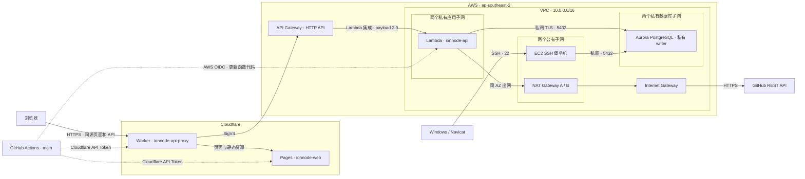

# IonNode · GitHub 资料管理

IonNode 是一次从 Web 开发到云端自动发布的全栈实践。登录后可以按用户名查询 GitHub 的公开资料，将资料保存到个人列表，修改备注或删除记录。各账号的保存记录独立。

- **[在线演示](https://ionnode-api-proxy.homeworkdev.workers.dev/)** · 使用 IonNode 邮箱账号登录，也可注册测试账号。
- **[首次自动部署记录](https://github.com/811271151/lonNode/actions/runs/44250772180)** · `main` 推送触发，提交 `11151d1`，运行成功。
- **[部署与运维手册](docs/deployment.md)** · 环境变量、生产迁移、手工发布、排错和资源清理。

## 演示流程

1. 从 Worker 地址打开首页，登录后进入个人工作台。
2. 查询 `octocat`，保存到「我的 GitHub 资料」。
3. 写入中文备注，刷新页面，确认会话仍有效且备注能读回。删除这条测试记录，确认列表已移除。
4. 退出，再打开工作台，确认页面跳转到登录页。

## 实际部署架构



- **浏览器入口。** Worker 将页面转发到 Pages，将白名单内的认证和 tRPC 请求转发到 API Gateway。页面与 API 使用同一个 Worker 地址，会话 Cookie 走同源请求。
- **两层身份。** AWS IAM 校验 Worker 的 SigV4 签名。Worker 验证受保护请求的会话，Lambda 的 tRPC 中间件再检查登录身份，业务查询和写入按当前用户 ID 限定。
- **私网访问。** Aurora 关闭公网访问。数据库的 5432 入站只允许 Lambda 和堡垒机安全组。Lambda 请求 GitHub 时，经应用子网对应的 NAT 出网。当前 Aurora 有一个 writer。
- **发布通道。** GitHub Actions 使用 OIDC 临时凭据更新 Lambda，用 Cloudflare API Token 部署 Pages 和 Worker。生产数据库迁移通过堡垒机隧道执行。

## 代码位置

| 路径 | 用途 |
| --- | --- |
| [apps/web](apps/web) | Next.js App Router、登录表单、GitHub 工作台、静态导出 |
| [apps/worker](apps/worker) | 页面转发、API 白名单、会话检查与 SigV4 |
| [apps/server](apps/server) | Hono HTTP 应用、Lambda 入口与构建配置 |
| [packages/api](packages/api) | tRPC 路由与共享类型，包含 GitHub 资料管理 |
| [packages/auth](packages/auth) | Better Auth 登录与会话配置 |
| [packages/db](packages/db) | Prisma schema、迁移及 PostgreSQL 客户端 |
| [部署工作流](.github/workflows/deploy.yml) | 构建、发布和公开入口检查 |

仓库中的设备页面和模拟器来自原 IoT 项目，相关需求记录见 [IoT MVP 说明](docs/requirement.md)。本次验收以 Web 资料管理和云部署为范围。

## 本地运行

使用 Node.js 24、仓库指定的 pnpm 10.34.4，以及一个单独用于开发的 PostgreSQL 数据库。从仓库根目录执行 `pnpm install --frozen-lockfile`，然后创建以下两个本地配置文件。

`apps/server/.env`：

```dotenv
NODE_ENV=development
BETTER_AUTH_SECRET=<本地生成的随机密钥，至少32字符>
BETTER_AUTH_URL=http://localhost:3000
CORS_ORIGIN=http://localhost:3001
DATABASE_URL=postgresql://<本地用户>:<URL编码后的密码>@localhost:5432/ionnode_dev?schema=public
```

`apps/web/.env`：

```dotenv
NEXT_PUBLIC_SERVER_URL=http://localhost:3000
```

将占位符换成本地值，提前创建 `ionnode_dev` 数据库。浏览器和配置统一使用 `localhost`。

```powershell
pnpm --filter '@IonNode/db' exec prisma migrate deploy
pnpm --filter '@IonNode/db' exec prisma generate --no-hints
```

从项目根目录开两个终端，分别执行：

```powershell
pnpm run dev:server
```

```powershell
pnpm run dev:web
```

打开 [http://localhost:3001](http://localhost:3001)。网页在本地直连 Hono，完整的 Worker、API Gateway 与 Lambda 链路可以通过在线入口验收。

## 已验证

| 检查项 | 结果与证据 |
| --- | --- |
| Web 与 GitHub API | 浏览器登录、刷新保活、查询、保存、中文备注读回、删除和退出通过 |
| 账号数据隔离 | B 的列表看不到 A 的记录，跨账号修改和删除返回 `404 NOT_FOUND`；A 确认原备注未变，随后可自行删除 |
| 私网与外部访问 | Navicat 经 SSH 隧道访问 Aurora，迁移成功；在线查询 `octocat` 验证 Lambda 能访问 GitHub |
| API 入口 | 未签名直连 API Gateway 返回 `403`，未登录访问 Worker 受保护接口返回 `401` |
| 自动发布 | [第 1 次运行](https://github.com/811271151/lonNode/actions/runs/44250772180) 完成 OIDC、Lambda、Pages、Worker 发布，以及首页与未登录会话接口检查 |

工作流的公开检查覆盖首页内容与未登录会话返回 `null`。登录后的业务流和双账号隔离由手工验收覆盖。重复保存行为由 upsert 和唯一约束实现，未单独进行线上的重复保存测试。
